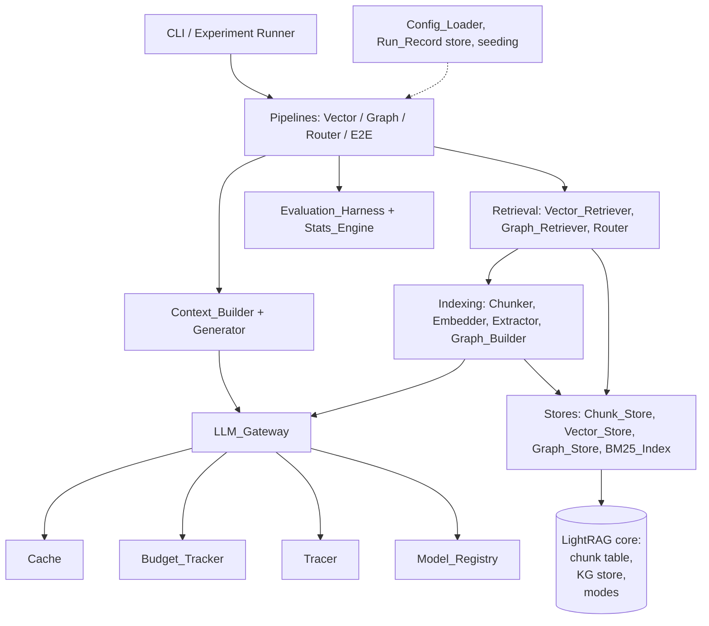

# Design Document

## Overview

Elevate-RAG is a research harness that builds one shared index serving both vector and graph
retrieval, places a learned query router on top, and measures when each retrieval path wins. This
document describes the software design that satisfies the 37 requirements: a phased Python 3.11+
project where every phase (0–7) is independently runnable and verifiable through a single
`exit-check` command on a bundled synthetic Tiny_Sample, offline with deterministic fakes, and with
real backends and models when the user provides them.

### Design principles

1. **One shared chunk table.** LightRAG owns the authoritative chunk store. Every retrieval path
   (BM25, dense, graph) reads the same chunks so that path comparisons are fair (Requirements 8, 11.5,
   12.8, 15.3). This is the central architectural commitment that makes RQ1–RQ6 answerable.
2. **No-setup first.** Nothing requires Docker or an API key to run end to end. The default stack is
   FAISS/NanoVectorDB + NetworkX + a local or fake embedder. Docker databases and API models are
   opt-in through configuration (Requirements 2, 3). This keeps database setup off the critical path.
3. **Everything through one gateway.** All LLM and embedding calls pass through `LLM_Gateway`, which
   centralises seeding, temperature, caching, token counting, spend tracking and tracing (Requirements
   3, 4). No component calls a provider SDK directly.
4. **Models and thresholds are configuration, not code.** Forward-dated model identifiers and
   open thresholds live in a frozen registry and typed config, so unavailable models or retuned
   thresholds never require code changes (Requirement 3, and the open-threshold defaults chosen below).
5. **Declarative, resumable, reproducible runs.** Experiments are declared in config files; every
   Run records seeds, git hash, model IDs, call dates and a config snapshot, and resumes from the
   cache and persisted Run_Records (Requirements 1, 29).
6. **Protocol-oriented seams.** Backends, models and frameworks sit behind `typing.Protocol`
   interfaces so fakes, embedded backends and Docker/API implementations are interchangeable. This is
   what lets the whole system run offline for tests (Requirement 37.3).

### Chosen defaults for open thresholds

The requirements leave several thresholds to the design. These defaults live in config and are
overridable; dev-split tuning may change them but never test-split.

| Parameter | Default | Rationale | Requirement |
|---|---|---|---|
| Contamination threshold (V0 flag) | EM ≥ 0.25 on a dataset | Closed-book EM above a quarter signals memorised answers; well above random for open-domain QA. | 14.4 |
| Merge_Threshold (entity cosine) | 0.88 | High-precision merge; ablation A2 sweeps {0.82, 0.88, 0.94}. | 16.1, 28.2 |
| Entity description merge limit | 8 descriptions | Summarise once an entity gathers more than 8 raw descriptions, bounding prompt size. | 16.4 |
| Answer_Entity_Coverage gate | 60% | Fixed by Requirement 18.3; fallback extractor below it. | 18.3 |
| Context_Token_Cap | 8,000 tokens | Fixed default by glossary; ablation A3 sweeps {4k, 8k, 16k}. | 13, 28.3 |
| RRF constant k | 60 | Fixed by glossary. | 12.3 |
| Reranker top-n | 8 (range 5–10) | Mid-range default. | 12.6 |
| Judge kappa pass | ≥ 0.6 | Fixed by Requirement 10.5. | 10.5 |
| Cache / retry | 5 attempts, exp. backoff base 2s | Standard transient-error policy. | 3.5 |

### What this design does not cover

Multimodal input, generator fine-tuning, access control/multi-tenancy, and agentic multi-round
retrieval beyond the single R4 escalation step are out of scope per the requirements.

## Architecture

### Layered view

The system is organised in layers, lower layers never importing higher ones:



### LightRAG integration approach

LightRAG (v1.5.7, MIT) is the framework of record. Elevate-RAG wraps rather than forks it:

- **Shared chunk table.** We inject a custom `chunking_func` into the `LightRAG` instance so the
  chunk boundaries, `chunk_id`s and token counts are produced by our `Chunker` and stored in
  LightRAG's chunk key-value store. `Chunk_Store` is a thin read adapter over that store; every
  other path reads chunks from it. This guarantees the shared-chunk invariant (Requirement 11.5).
- **Per-role LLMs.** LightRAG accepts an `llm_model_func` (used for extraction and generation inside
  the framework) and an `embedding_func`. We pass thin adapters that route to `LLM_Gateway` with the
  correct role (extraction vs generator), so temperature, seeding, caching and spend tracking apply
  uniformly, and extraction and generator models can differ within one Run (Requirement 3.7).
- **Retrieval without generation.** For evaluation we need the retrieved context separately from the
  generated answer. LightRAG exposes `aquery_data` / `query_data`, which run the full retrieval for a
  mode (`naive|local|global|hybrid|mix`) and return structured entities, relationships and chunks
  **without** calling the generator. Our `Graph_Retriever` calls this, then hands the context to our
  own `Context_Builder` and `Generator` so the prompt, citation parsing, refusal handling and
  Context_Token_Cap are identical across vector and graph paths (Requirement 13.3).
- **Storage backends.** LightRAG's pluggable `*_storage` parameters select the vector and graph
  backends. Our `Vector_Store`/`Graph_Store` protocols map onto LightRAG's storage choices for the
  modes LightRAG serves, and are used directly by the vector baseline for BM25/dense/RRF.
- **QueryParam mapping.** `Retrieval_Mode` values map to `QueryParam(mode=..., top_k=..., chunk_top_k=...)`;
  graph depth 2 (Requirement 17.6) and community layer (Requirement 16.6) map to LightRAG addon params.

### Phase structure and exit checks

Each phase ships a `Phase_Report` and an `exit-check` subcommand that runs on the Tiny_Sample in
under 15 minutes on a laptop CPU, prints one pass/fail/skipped line per check, and exits 0/non-zero
(Requirement 36). The CLI dispatches phases:

```
elevate verify-setup            # Req 5.6
elevate exit-check --phase N    # Req 36
elevate run <pipeline> ...      # per-pipeline
elevate experiment <file>       # Req 29
elevate e2e [--tiny|--config f] # Req 35
```

### Repository layout

```
elevate_rag/
  pyproject.toml            # Python 3.11+, deps pinned; uv.lock / requirements.lock
  .env.example              # Req 1.5
  README.md                 # Req 37.5
  docs/
    SETUP.md  DATASETS.md  MODELS.md            # Req 5
    annotation/             # triple-audit, judge, error-tag guidelines (Req 32.6)
    phase-reports/phase-0.md ... phase-7.md     # Req 36.1
  docker/
    qdrant.yml milvus.yml pgvector.yml
    neo4j.yml memgraph.yml postgres-graph.yml   # Req 2.4
  configs/
    models.yaml             # Model_Registry (Req 3.1)
    defaults.yaml           # thresholds, caps, seeds
    experiments/E1..E6.yaml A1..A4.yaml         # Req 29.1
    routers/r1_rules.yaml   # Req 20.2
  fixtures/tiny_sample/     # bundled synthetic corpus+questions (Req 5.7)
  src/elevate/
    __init__.py
    cli.py                  # entry point (Req 1.1)
    config/                 # Config_Loader, schema, env (Req 1,3.8)
    core/                   # seeding, run_record, ids, tokens, errors
    gateway/                # LLM_Gateway, Model_Registry, Cache, Budget_Tracker, Tracer
    data/                   # loaders, normalise, splits, tiny_sample
    chunking/               # Chunker + LightRAG chunking_func adapter
    stores/                 # Chunk_Store, Vector_Store, Graph_Store, BM25_Index + backends
    vector/                 # Embedder, Vector_Retriever, RRF, Reranker, variants V0-V4
    generation/             # Context_Builder, Generator
    graph/                  # Extractor, Entity_Resolver, Graph_Builder, Community_Builder,
                            #   Graph_Retriever, Graph_Quality_Checker, adapters
    router/                 # R0-R4, Oracle_Router
    eval/                   # Evaluation_Harness, metrics, LLM_Judge, RAGAS adapter
    stats/                  # Stats_Engine
    analysis/               # Error_Analyzer, Annotation_Tool
    report/                 # Report_Builder
    experiments/            # Experiment_Runner, DB_Benchmark
    lightrag_bridge/        # LightRAG construction, adapters, reference-system adapters
  tests/
    unit/ property/ integration/ fixtures/
```

## Components and Interfaces

Interfaces are Python `Protocol`s so fakes and real implementations are structurally
interchangeable. Only representative signatures are shown.

### Core and configuration

```python
class ConfigLoader(Protocol):
    def load(self, path: Path) -> ExperimentConfig: ...
    # Raises ConfigError naming file/field/expected-type on unknown/missing/wrong-type (Req 1.3)

def set_global_seeds(seed: int) -> SeedRecord: ...        # Python, NumPy, torch (Req 1.6)
def open_run(cfg: ExperimentConfig) -> RunRecord: ...     # snapshot, git hash, versions (Req 1.7)
```

`ExperimentConfig` is a pydantic model (typed schema, Req 1.2). `ConfigLoader` rejects unknown
fields (`extra="forbid"`), reports the file, field and expected type on failure, and cross-validates
that the judge and generator belong to different model families (Requirement 3.8). Secrets load from
env/`.env` and are stored as a `SecretStr` that never serialises into logs or Run_Records
(Requirement 1.4).

### Gateway, registry, cache, budget, tracer

```python
class ModelRegistry(Protocol):
    def entry(self, role: ModelRole) -> ModelEntry: ...   # provider, id, version, ctx, price (Req 3.1)

class LLMGateway(Protocol):
    def complete(self, role: ModelRole, prompt: Prompt, *, json: bool = False) -> LLMResult: ...
    def embed(self, role: ModelRole, texts: Sequence[str]) -> list[Vector]: ...
    # temp=0, seed passthrough, retry w/ backoff, JSON repair+retry, token+cost log (Req 3)

class Cache(Protocol):
    def get_or_call(self, key: CacheKey, thunk: Callable[[], T]) -> T: ...  # content-hash (Req 4.1,4.2)

class BudgetTracker(Protocol):
    def charge(self, cost_usd: float) -> None: ...        # raises BudgetExceeded at cap (Req 4.4)
    def estimate(self, sample_fraction: float) -> CostEstimate: ...        # 5% extrapolation (Req 4.5)

class Tracer(Protocol):
    def trace(self, call: LLMTrace) -> None: ...          # Langfuse or local JSONL (Req 4.6,4.7)
```

`LLMGateway` composes the others: it computes the cache key from `(content_hash, model_id, params)`,
returns cached results without a provider call, charges the `BudgetTracker` only on uncached calls,
and emits a `Tracer` record per call. JSON responses get one repair pass and one re-request before
being marked malformed (Requirement 3.6).

### Data, chunking, stores

```python
class DatasetLoader(Protocol):
    name: str
    def load(self, raw_dir: Path, out_dir: Path) -> tuple[Path, Path]: ...  # corpus, questions (Req 6.1)

class Splitter(Protocol):
    def split(self, questions: QuestionSet, seed: int) -> SplitResult: ...  # 20/80 stratified (Req 7)
    def tiny_sample(self, questions: QuestionSet, corpus: Corpus) -> TinySample: ...

class Chunker(Protocol):
    def chunk(self, doc: Document, cfg: ChunkConfig) -> list[Chunk]: ...     # deterministic (Req 8)
    def as_lightrag_func(self) -> Callable: ...                             # inject into LightRAG

class ChunkStore(Protocol):
    def get(self, chunk_id: str) -> Chunk: ...
    def ids(self) -> set[str]: ...                     # authoritative id set (Req 11.5)

class VectorStore(Protocol):
    def upsert(self, items: Sequence[VectorItem]) -> None: ...
    def search(self, q: Vector, k: int, source: str | None = None) -> list[Hit]: ...
    def index_params(self) -> dict: ...                # HNSW M/ef_* reporting (Req 2.1, 11.3)

class GraphStore(Protocol):
    def upsert_node(self, node: Node) -> None: ...
    def upsert_edge(self, edge: Edge) -> None: ...
    def entity_by_name(self, name: str) -> Node | None: ...
    def neighbours(self, name: str, hops: int) -> Subgraph: ...   # 1-hop/2-hop (Req 2.2)
```

Backends implement these protocols: `FaissVectorStore`, `NanoVectorStore`, `QdrantVectorStore`,
`MilvusVectorStore`, `PgvectorStore`; `NetworkxGraphStore`, `Neo4jGraphStore`, `MemgraphGraphStore`,
`PostgresGraphStore`. A `health_check()` reports backend name/version/status and raises a
`BackendError` referencing Setup_Docs on failure (Requirements 2.5, 2.6).

### Vector path

```python
class Embedder(Protocol):
    model_id: str
    def embed(self, texts: Sequence[str]) -> list[Vector]: ...   # tags vectors w/ model id (Req 11.1)

def rrf_fuse(rankings: Sequence[list[str]], k: int = 60) -> list[str]: ...  # confluence (Req 12.4)

class Reranker(Protocol):
    def rerank(self, query: str, candidates: Sequence[Chunk], top_n: int) -> list[Scored]: ...

class VectorRetriever(Protocol):
    def retrieve(self, query: str, variant: VectorVariant) -> RetrievalResult: ...  # V0-V4 (Req 12,14)
```

`FakeEmbedder` (hash-based deterministic vectors) and `FakeReranker` are the offline defaults;
`SentenceTransformerEmbedder` and a cross-encoder reranker are the local real implementations.

### Generation

```python
class ContextBuilder(Protocol):
    def build(self, parts: RetrievalResult, cap: int) -> NumberedContext: ...  # ≤ cap (Req 13.1,13.2)

class Generator(Protocol):
    def generate(self, question: str, ctx: NumberedContext) -> GeneratedAnswer: ...
    # fixed versioned prompt; cites passage numbers; Refusal_String; records invalid citations (Req 13)
```

### Graph path

```python
class Extractor(Protocol):
    def extract(self, chunk: Chunk) -> ExtractionResult: ...   # entities+relations, source_id (Req 15)

class EntityResolver(Protocol):
    def resolve(self, entities: Sequence[Entity], threshold: float) -> list[Entity]: ...  # idempotent

class GraphBuilder(Protocol):
    def build(self, chunks: Sequence[Chunk], cfg: GraphConfig) -> GraphBuildResult: ...

class GraphRetriever(Protocol):
    def retrieve(self, query: str, mode: GraphMode, depth: int) -> RetrievalResult: ...  # via aquery_data

class GraphQualityChecker(Protocol):
    def check(self, graph: GraphStore, questions: QuestionSet) -> GraphQualityReport: ...  # coverage (Req 18)
```

Reference/alternative systems (Microsoft GraphRAG, HippoRAG 2, LlamaIndex PropertyGraphIndex, Neo4j
GraphRAG) implement a single `SystemAdapter.run(question) -> RunItem` returning answers and retrieved
passages in Run_Record format over the shared Chunk_Store (Requirement 19).

### Router

```python
class Router(Protocol):
    level: RouterLevel  # R0..R4
    def route(self, query: str) -> RouteDecision: ...   # exactly one mode + reason (Req 20.3,20.4)

class OracleRouter(Protocol):
    def assign(self, per_mode: Mapping[Mode, RunRecord]) -> dict[str, OracleChoice]: ...  # Req 23
```

R2 is TF-IDF+SVM (or a small encoder) with `save`/`load` producing identical predictions
(Requirement 21.6). R4 runs a cheap mode, then escalates to `mix` at most once when the top reranker
score is below the dev-tuned threshold or the answer equals the Refusal_String (Requirement 22).

### Evaluation, stats, analysis, report

```python
class EvaluationHarness(Protocol):
    def evaluate(self, run: RunRecord) -> MetricsSummary: ...   # recall/nDCG/EM/F1/judge/RAGAS/latency/cost

class LLMJudge(Protocol):
    def grade(self, item: QAItem) -> JudgeLabel: ...            # correct|partial|wrong (Req 10.1)
    def compare(self, a: str, b: str) -> PairLabel: ...         # order-swapped, ties (Req 10.2,10.3)

class StatsEngine(Protocol):
    def bootstrap_ci(self, samples: Sequence[float]) -> CI: ... # 1000 resamples, seed (Req 30.1)
    def mcnemar(self, paired: PairedBinary) -> TestResult: ...
    def holm_bonferroni(self, pvals: Mapping[str, float]) -> dict[str, float]: ...

class AnnotationTool(Protocol):
    def export(self, items, path) -> None: ...
    def import_sheet(self, path) -> ImportResult: ...           # validates labels (Req 32.2)
    def cohens_kappa(self, a, b) -> float: ...
```

## Data Models

All records are pydantic models with JSON/JSONL serialisation. Key models:

```python
class Document(BaseModel):
    doc_id: str; title: str; text: str; source: str          # Normalised_Corpus record (Req 6)

class Question(BaseModel):
    question_id: str; question: str; answers: list[str]
    gold_passage_ids: list[str]; query_type: QueryType
    answerable: bool; split: Literal["dev", "test"] | None

class Chunk(BaseModel):
    chunk_id: str; doc_id: str; text: str
    token_count: int; start_offset: int; end_offset: int     # Chunk_Store record (Req 8.3)

class Entity(BaseModel):
    name: str; type: str; descriptions: list[str]
    source_chunk_ids: list[str]; profile_embedding: Vector | None  # (Req 15.1,15.2)

class Relation(BaseModel):
    source: str; relation: str; target: str
    description: str; weight: float; source_chunk_ids: list[str]

class RouteDecision(BaseModel):
    mode: Mode; level: RouterLevel; reason: str
    cheap_attempt: Attempt | None; escalated_attempt: Attempt | None   # (Req 22.5)

class RunItem(BaseModel):
    question_id: str; prediction: str; retrieved_chunk_ids: list[str]
    cited_chunk_ids: list[str]; invalid_citations: list[int]
    route: RouteDecision | None; judge: JudgeLabel | None
    prompt_tokens: int; completion_tokens: int; latency_ms: float; cost_usd: float

class RunRecord(BaseModel):
    run_id: str; dataset: str; split: str; pipeline: str
    config_snapshot: dict; model_ids: dict[str, str]; call_dates: list[str]
    git_commit: str; seeds: SeedRecord; library_versions: dict[str, str]
    items: list[RunItem]; summary: MetricsSummary | None     # (Req 1.6,1.7, 9.11)
```

`QueryType` ∈ {single-hop, multi-hop, comparison, temporal, global, null}. `Mode` is the union of
vector variants (V0–V4) and graph modes (naive, local, global, hybrid, mix). Normalised_Corpus and
Question_Set persist as JSONL; Run_Records persist as per-query JSONL plus a summary JSON
(Requirement 9.11). Referential integrity (every gold/source `chunk_id` exists) and partition
(dev ∪ test = full, disjoint) are enforced at write time and are stated as correctness properties
below.

## Correctness Properties

*A property is a characteristic or behavior that should hold true across all valid executions of a
system — essentially, a formal statement about what the system should do. Properties serve as the
bridge between human-readable specifications and machine-verifiable correctness guarantees.*

These properties are derived from the acceptance criteria that Requirement 37.2 designates for
property-based testing. Each is universally quantified and maps to its originating requirement.

### Property 1: Cache idempotence

*For any* cacheable request (LLM, embedding or retrieval), issuing the same request twice SHALL
result in exactly one underlying provider call and two identical returned results.

**Validates: Requirements 4.1, 4.2**

### Property 2: Corpus serialisation round-trip

*For any* Normalised_Corpus, writing it to JSONL and reading it back SHALL produce records equal to
the originals.

**Validates: Requirements 6.10**

### Property 3: Gold-passage referential integrity

*For any* loaded dataset, every gold passage ID attached to a question SHALL exist in the
Normalised_Corpus.

**Validates: Requirements 6.11**

### Property 4: Dataset load determinism

*For any* fixed raw input and seed, loading the dataset twice SHALL produce identical
Normalised_Corpus and Question_Set outputs.

**Validates: Requirements 6.12**

### Property 5: Split partition

*For any* Question_Set, the dev and test splits SHALL be disjoint and their union SHALL equal the
full Question_Set, with each Query_Type stratum present in both splits at the configured ratio.

**Validates: Requirements 7.1, 7.2**

### Property 6: Chunk size invariant

*For any* document and chunk configuration, every produced chunk SHALL have a token count at or below
the configured maximum.

**Validates: Requirements 8.4**

### Property 7: Chunk coverage

*For any* document, concatenating its chunk texts with overlaps removed SHALL reproduce the document
text modulo whitespace normalisation.

**Validates: Requirements 8.5**

### Property 8: Chunk determinism

*For any* document and configuration, chunking it twice SHALL produce identical `chunk_id` values and
chunk texts.

**Validates: Requirements 8.6**

### Property 9: Answer normalisation idempotence

*For any* answer string, normalising an already-normalised string SHALL return the same string.

**Validates: Requirements 9.3**

### Property 10: Metric reflexivity

*For any* answer string, exact match of the string against itself SHALL equal 1 and token F1 SHALL
equal 1.

**Validates: Requirements 9.4**

### Property 11: RRF confluence

*For any* set of input ranked lists, RRF fusion SHALL produce the same fused ranking regardless of
the order in which the input lists are supplied.

**Validates: Requirements 12.4**

### Property 12: RRF monotonicity

*For any* set of input ranked lists, a chunk ranked first in every input list SHALL be ranked first
in the fused list.

**Validates: Requirements 12.5**

### Property 13: Reranker subset and ordering

*For any* set of candidate chunks, the reranker output SHALL be a subset of the input candidates and
SHALL be sorted by descending reranker score.

**Validates: Requirements 12.7**

### Property 14: Context token budget

*For any* retrieval output and configured cap, the context produced by the Context_Builder SHALL have
a token count at or below the Context_Token_Cap.

**Validates: Requirements 13.2**

### Property 15: Graph provenance

*For any* constructed graph, every source `chunk_id` referenced by an entity or relation SHALL exist
in the Chunk_Store.

**Validates: Requirements 15.3**

### Property 16: Entity-resolution idempotence

*For any* entity set, running the Entity_Resolver on an already-resolved set SHALL produce the same
entity set.

**Validates: Requirements 16.2**

### Property 17: Entity-resolution reduction

*For any* entity set, the number of entities after resolution SHALL be at most the number before
resolution.

**Validates: Requirements 16.3**

### Property 18: Router totality

*For any* query and Router_Level, the Router SHALL return exactly one Retrieval_Mode drawn from the
configured set.

**Validates: Requirements 20.3**

### Property 19: R2 model save/load round-trip

*For any* trained R2 model and batch of queries, saving then loading the model SHALL produce
predictions identical to the original model's predictions.

**Validates: Requirements 21.6**

### Property 20: Oracle regret bound

*For any* router evaluation over a set of per-mode Run_Records, regret (oracle accuracy minus router
accuracy) SHALL be greater than or equal to zero.

**Validates: Requirements 23.4**

### Property 21: Graph backend equivalence

*For any* graph and entity, 1-hop and 2-hop neighbour fetches SHALL return the same neighbour set
across any two graph backends.

**Validates: Requirements 25.4**

### Property 22: Bootstrap interval invariant

*For any* sample of metric values, the bootstrap confidence interval SHALL contain the point
estimate.

**Validates: Requirements 30.5**

### Property 23: Multiple-comparison correction invariant

*For any* family of p-values, each Holm–Bonferroni adjusted p-value SHALL be greater than or equal to
its raw p-value and at most 1.

**Validates: Requirements 30.6**

### Property 24: Kappa agreement

*For any* pair of identical label sequences containing more than one distinct label, Cohen's kappa
SHALL equal 1.

**Validates: Requirements 32.4**

### Property 25: Annotation sheet round-trip

*For any* annotation sheet, exporting then importing an unmodified sheet SHALL reproduce the original
items.

**Validates: Requirements 32.5**

## Error Handling

The system distinguishes user-fixable errors (fail fast with actionable guidance) from transient
errors (retry) from in-run data errors (record, continue, report).

### Error taxonomy

```python
class ElevateError(Exception): ...            # base
class ConfigError(ElevateError): ...          # names file, field, expected type (Req 1.3, 3.8)
class BackendError(ElevateError): ...         # names backend, references Setup_Docs (Req 2.6)
class ModelCallError(ElevateError): ...       # names model, last failure reason (Req 3.5)
class BudgetExceeded(ElevateError): ...        # spent amount, remaining work (Req 4.4)
class DatasetError(ElevateError): ...         # names file, missing field, DATASETS.md section (Req 6.9)
class EmbeddingMismatchError(ElevateError): ... # names both model identifiers (Req 11.2)
class TuningOnTestError(ElevateError): ...    # tuning restricted to dev (Req 7.3, 14.3)
```

### Handling strategies by layer

- **Configuration (fail fast):** unknown/missing/wrong-type fields and judge-equals-generator-family
  stop before any model call, naming the exact offending location (Requirements 1.3, 3.8).
- **Secrets:** redacted everywhere; a `SecretStr` wrapper prevents accidental serialisation into
  logs, Run_Records and error messages (Requirement 1.4).
- **Backends (fail fast with pointer):** a failed health check stops the Run and references the
  matching Setup_Docs section (Requirement 2.6). In exit-checks, an unavailable backend is marked
  *skipped* rather than failed (Requirements 26.5, 36.5).
- **Transient model errors (retry):** exponential backoff up to the configured maximum attempts, then
  `ModelCallError` naming the model and last failure (Requirement 3.5).
- **Malformed JSON (repair then re-request):** one repair pass and one re-request; still-malformed
  output is recorded as malformed without aborting the Run (Requirements 3.6, 10.4, 15.5).
- **In-run data errors (record and continue):** a chunk whose extraction stays malformed is recorded
  as failed and counted; remaining chunks proceed (Requirement 15.5). An unparseable judge output
  marks the item unjudged and excludes it from accuracy with a reported count (Requirement 10.4). An
  invalid citation is recorded, not fatal (Requirement 13.6).
- **Budget (stop and persist):** reaching the Spending_Cap stops the Run, persists completed results,
  and reports spent and remaining work so the Run can resume from cache (Requirements 4.4, 29.2).
- **End-to-end (stop, report, keep partial):** a failed stage reports the failed stage and error and
  retains completed-stage outputs for resumption (Requirement 35.4).

### Determinism and guardrails

Any tuning operation requested against the test split raises `TuningOnTestError` (Requirements 7.3,
14.3). Seeds for Python, NumPy and the ML framework are set at Run start and recorded; bootstrap and
sampling steps take explicit seeds so reruns reproduce exactly (Requirements 1.6, 30.1, 31.1).

## Testing Strategy

The project uses a dual approach: **unit tests** for specific examples, edge cases and error
conditions, and **property-based tests** (Hypothesis) for the universal properties above. Integration
tests run only when the corresponding prerequisite (Docker DB or API key) is present.

### Why property-based testing applies here

Most of Elevate-RAG's correctness-critical logic is pure, input-driven transformation: chunking,
serialization round-trips, RRF fusion, reranking order, answer normalisation and metric computation,
entity resolution, split partitioning, statistics, and annotation import/export. These have clear
"for all inputs X, property P(X) holds" statements and a large input space, which is exactly where
PBT finds bugs that example tests miss. The 25 properties above cover the criteria Requirement 37.2
mandates.

Parts of the system that are **not** suitable for PBT use other strategies:

- Docker database wiring, connectivity health checks and the Langfuse tracer → integration/smoke
  tests with 1–3 examples (Requirements 2.5, 4.6).
- CLI phase dispatch, Phase_Report generation and Report_Builder figures → example and
  snapshot tests (Requirements 33, 36).
- External LLM/provider behaviour → mocked with deterministic fakes offline; a thin integration test
  when a key is present (Requirements 3, 37.3, 37.4).
- DB micro-benchmark numbers (QPS, latency) → performance smoke runs, not asserted properties.

### Property-based test configuration

- Library: **Hypothesis**. Property tests implement each property with a **single** property-based
  test running **at least 100 iterations** (`@settings(max_examples=100)` or higher).
- Each property test carries a comment tag referencing its design property, in the format:
  **Feature: hybrid-vector-graph-rag, Property {number}: {property_text}**.
- Custom Hypothesis strategies generate Documents, Corpora, Question_Sets, ranked lists, Entity sets,
  label sequences and metric samples; edge cases (empty text, all-whitespace, unicode, duplicate
  entities, single-element lists, ties in rankings) are produced by the generators rather than
  separate tests where possible.
- Properties 1–25 map one-to-one to property test functions under `tests/property/`.

### Offline determinism

All unit and property tests run without network access or API keys by injecting deterministic fakes
through the same Protocols the production code uses: `FakeLLMGateway` (scripted/record-replay
responses with a call counter for the cache idempotence property), `FakeEmbedder` (hash-based
vectors), `FakeReranker`, and in-memory `Chunk_Store`/`Vector_Store`/`Graph_Store`. This satisfies
Requirements 8.8 (offline lint/type/test), 37.3.

### Integration and smoke tests

- Database backends: each `VectorStore`/`GraphStore` implementation has an integration test that
  runs only when its Docker stack health check passes; Property 21 (backend equivalence) runs across
  any two available graph backends (Requirements 25.4, 37.4).
- Model providers: one smoke test per configured provider when the key is present, verifying a
  round-trip through `LLM_Gateway` (Requirement 37.4).
- Judge validation: the Cohen's-kappa-≥-0.6 check against 100 hand-labelled answers is an operational
  check surfaced by the CLI, not a unit test (Requirement 10.5).

### Exit-check tests

Each phase's `exit-check` is itself covered by an end-to-end test on the synthetic Tiny_Sample with
fakes, asserting a pass result and a non-zero exit on an injected failure (Requirements 36.3, 36.4).
The Phase 1 (G1), Phase 2 (G2), Phase 3 (G3) and Phase 6 (G4) gates each have a dedicated
Tiny_Sample test. The full `e2e --tiny` run (Requirement 35.1) is exercised as the top-level
integration test of the offline stack.

### Coverage targets

- Every pure component (`config`, `chunking`, `vector/rrf`, `vector/reranker`, `generation/context`,
  `graph/resolver`, `eval/metrics`, `stats`, `analysis/annotation`, `router`) has unit tests.
- Static type checking and linting pass with zero errors on all public functions
  (Requirement 37.1).
