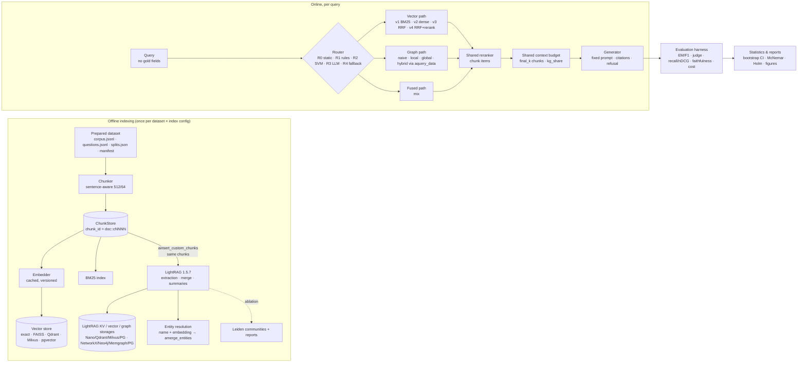

# Architecture

Elevate-RAG implements the plan's *one shared index, many retrieval paths, one router* design.
LightRAG 1.5.7 is the graph engine; everything around it (chunk identity, vector baselines,
reranking, budgets, generation, routing, evaluation, statistics) is Elevate-RAG code with
explicit interfaces.

## Components and module map

| # | Spec component | Module(s) |
|---|---|---|
| 1–2 | Dataset ingestion, normalisation, validation, splitting | `data/datasets.py`, `data/prepare.py`, `data/synthetic.py` |
| 3 | Shared documents and chunks | `indexing/chunker.py`, `indexing/chunk_store.py` |
| 4 | Embedding providers | `providers/embeddings.py` (hash · sentence-transformers · OpenAI-compatible) |
| 5–7 | Sparse, dense, hybrid + RRF | `retrieval/lexical.py`, `pipeline.py` (`retrieve`) |
| 8 | Cross-encoder reranking | `providers/rerank.py` (lexical · cross-encoder · Cohere/Jina HTTP) |
| 9–10 | Extraction, resolution, graph construction | LightRAG via `graph/lightrag_engine.py`; `graph/resolution.py` |
| 11–12 | Vector / graph storage adapters | `storage/vector.py`, `storage/graph.py`; LightRAG storages by config |
| 13–14 | Graph and fused retrieval | `graph/lightrag_engine.py` (`aquery_data`, 2-hop expansion), `graph/community.py` |
| 15 | Routing | `routing/router.py`, `routing/fallback.py`, `routing/oracle.py` |
| 16–17 | Context budget, generation, citations | `generation/context.py`, `generation/generator.py` |
| 18 | Metrics | `evaluation/metrics.py`, `evaluation/llm_metrics.py`, `evaluation/judge.py` |
| 19 | Statistics | `stats.py` |
| 20 | Experiment orchestration | `experiments/runner.py`, `experiments/external.py` |
| 21 | Caching, checkpointing | `cache.py`, `harness.run_questions` (resumable), LightRAG progress file |
| 22 | Observability, cost | `providers/base.py` (`UsageLedger`, `collect_calls`), `utils.configure_logging` |
| 23 | Reporting, visualisation | `reporting/report.py` |
| – | Benchmarks (Level A) | `benchmarks/dbbench.py` |
| – | CLI / demo | `cli/main.py`, `demo.py` |

## Key invariants (and where they are enforced)

* **Same chunks everywhere.** LightRAG receives our chunks through `ainsert_custom_chunks`;
  `LightRAGEngine.verify_chunk_identity` checks stored content after every index build, and an
  integration test reproduces LightRAG's IDs with its public `make_custom_chunk_id` (D-02).
* **Provenance.** Every entity/relation `source_id` is mapped back to Elevate-RAG chunk IDs;
  `graph_quality` reports nodes/edges without provenance (must be 0).
* **Same budget, reranker, prompt.** `ElevateRAG.answer` is the only generation path; all modes
  go through `assemble_context` and `Generator` (D-03, D-07). V1–V3 skip the reranker by
  definition.
* **No leakage.** The online pipeline receives `Query(query_id, text)` only; gold fields are used
  in `score_rows` after generation. Router training refuses the test split; R4 thresholds are
  tuned on dev.
* **Index versioning.** `PipelineConfig.index_key()` hashes corpus, chunking, embedder,
  extractor, resolution and community settings; any change creates a new index directory and a
  new LightRAG workspace (D-20).
* **Cost control.** `UsageLedger.check_budget` runs *before* every paid call; a breach raises
  `BudgetExceededError`, which aborts the run instead of being recorded as a per-question error.
* **Reproducibility.** Per-question rows carry run ID, dataset version, config hash, model IDs,
  calls (cached flag, tokens, cost, latency). Run manifests are immutable.
* **Portable run identity.** `config_hash()` covers everything that can change an output and
  nothing that only says where or how fast (storage paths, model-server URLs, concurrency,
  timeouts; D-29, D-30), so a run resumes on another disk, machine or cluster node.
* **Latency honesty.** Summaries compute latency only over queries whose LLM calls ran
  (`latency_n`, `cache_hit_rate`), never from cache hits.

## Execution environments

The same CLI and configs run everywhere; only the pipeline config (which models, which storage)
and the environment (paths, server URLs) change. See [RUNNING.md](RUNNING.md).

| Environment | Model serving | Storage | Orchestration |
|---|---|---|---|
| laptop | Ollama (OpenAI-compatible) | exact/FAISS + NetworkX, or Docker Qdrant + Neo4j | `scripts/run_pipeline.sh` |
| GPU workstation | vLLM | FAISS + NetworkX | `scripts/run_pipeline.sh` |
| SLURM cluster | vLLM started inside each GPU job | FAISS + NetworkX | `infrastructure/cluster/submit.sh`: index job → experiment job array (`--shard K/N`) → report job |
| EC2 | any | Docker databases on the instance | Docker image (`Dockerfile`) |

Experiment specs are re-targeted without editing (`--pipeline`, `--datasets`, `--limit`), and the
run id follows from the resulting config, so the same spec on two setups never collides.

## Data flow of one query record (`QueryRecord`)

`question_id, mode, route{level, query_type, reasons, initial_mode, escalated, reason…},
retrieved_chunk_ids (ranked), candidate_chunk_ids (pre-rerank), context_item_ids (exactly what the
LLM saw), context_items[kind, source_chunk_ids], scores, top_score, context_tokens, answer,
refused, citations, invalid_citations, cited_chunk_ids, timings{retrieval, rerank, generation,
graph_retrieval…}, calls[role, provider, model, tokens, cost_usd, cached, latency], prompt_tokens,
completion_tokens, cost_usd (None = unknown), error`.
