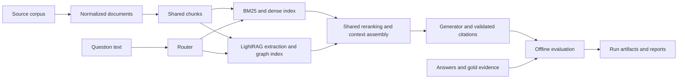

# Architecture

The immutable passage index serves both dense baseline search and LightRAG's passage lookup and ranking. A read-through adapter maps native document-scoped IDs to the shared corpus IDs. Native entity and relationship stores hold graph-specific representations. The graph pilot has its own size-limited index and workspace.

The query boundary accepts plain question text. Gold evidence and task labels reside in the dataset's question records and join the output offline by question ID. Indexed passages carry stable shared IDs and source document identities. Cache entries are versioned by inputs and configuration. The experiment runner records outcomes and provenance per question and reuses completed checkpoints on resume.
