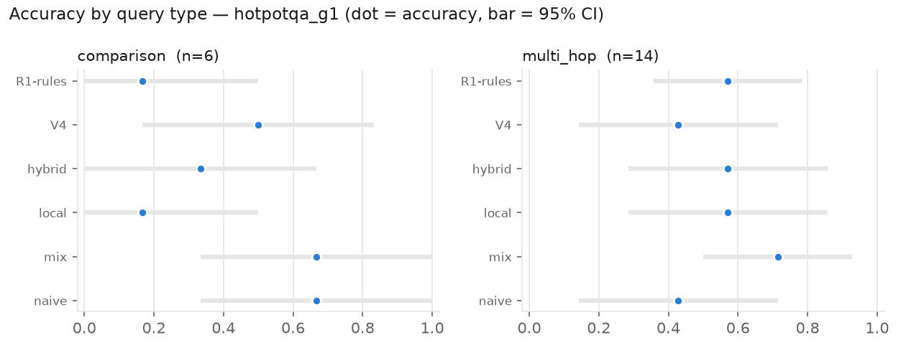
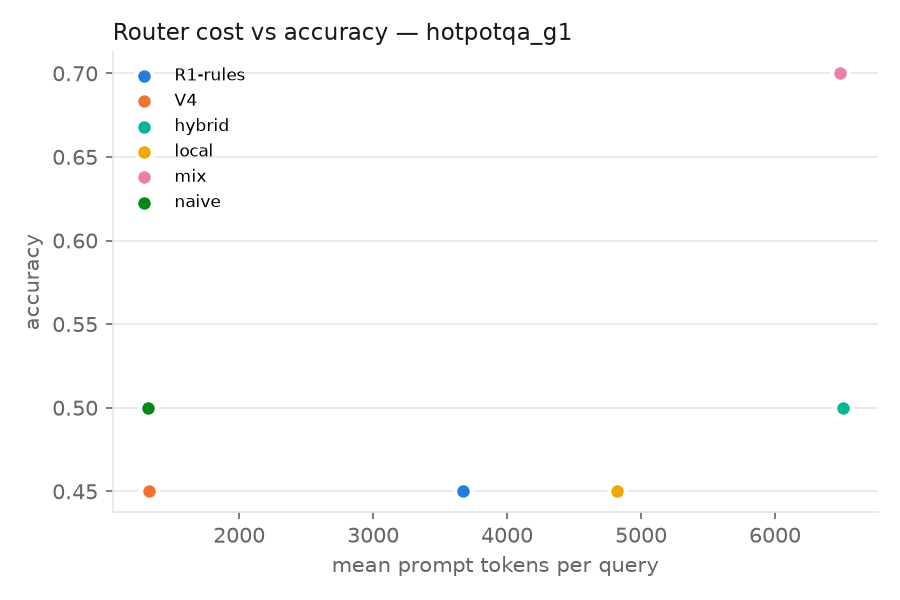
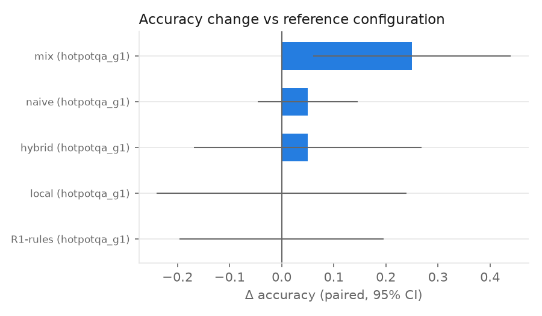

# Elevate-RAG results

## Runs

| experiment | variant | dataset | demo | n | accuracy | accuracy_ci | f1 | em | recall@10 | ndcg@10 | refusal_correct | error_rate | latency_p50_s | latency_p95_s | cache_hit_rate | prompt_tokens_mean | context_tokens_mean | cost_per_1k_queries_usd |
|---|---|---|---|---|---|---|---|---|---|---|---|---|---|---|---|---|---|---|
| G1 | R1-rules | hotpotqa_g1 | False | 20 | 0.450 | [0.250, 0.651] | 0.115 | 0.050 | 0.950 | 0.903 | 0.750 | 0.000 | — | — | 1.000 | 3672.250 | 2253.200 | 0.000 |
| G1 | V4 | hotpotqa_g1 | False | 20 | 0.450 | [0.250, 0.700] | 0.206 | 0.150 | 1.000 | 0.941 | 0.850 | 0.000 | 22.220 | 40.729 | 0.000 | 1326.800 | 1001.450 | 0.000 |
| G1 | hybrid | hotpotqa_g1 | False | 20 | 0.500 | [0.250, 0.700] | 0.099 | 0.050 | 0.925 | 0.887 | 0.850 | 0.000 | — | — | 0.550 | 6505.250 | 3818.700 | 0.000 |
| G1 | local | hotpotqa_g1 | False | 20 | 0.450 | [0.250, 0.650] | 0.098 | 0.050 | 0.900 | 0.860 | 0.800 | 0.000 | 54.960 | 103.670 | 0.000 | 4817.650 | 2695.600 | 0.000 |
| G1 | mix | hotpotqa_g1 | False | 20 | 0.700 | [0.500, 0.900] | 0.137 | 0.050 | 1.000 | 0.941 | 0.900 | 0.000 | — | — | 0.625 | 6484.500 | 3800.250 | 0.000 |
| G1 | naive | hotpotqa_g1 | False | 20 | 0.500 | [0.299, 0.750] | 0.189 | 0.150 | 1.000 | 0.941 | 0.850 | 0.000 | 11.642 | 27.435 | 0.500 | 1315.650 | 992.150 | 0.000 |

## Paired comparisons (McNemar, Holm-corrected)

| experiment | dataset | variant | reference | n | diff | ci_low | ci_high | p | p_holm | significant |
|---|---|---|---|---|---|---|---|---|---|---|
| G1 | hotpotqa_g1 | R1-rules | V4 | 20 | 0.000 | -0.196 | 0.196 | 1.000 | 1.000 | False |
| G1 | hotpotqa_g1 | hybrid | V4 | 20 | 0.050 | -0.168 | 0.268 | 1.000 | 1.000 | False |
| G1 | hotpotqa_g1 | local | V4 | 20 | 0.000 | -0.240 | 0.240 | 1.000 | 1.000 | False |
| G1 | hotpotqa_g1 | mix | V4 | 20 | 0.250 | 0.060 | 0.440 | 0.062 | 0.312 | False |
| G1 | hotpotqa_g1 | naive | V4 | 20 | 0.050 | -0.046 | 0.146 | 1.000 | 1.000 | False |

Differences whose CI includes 0 are *no clear difference*, not evidence of equivalence.

## Figures

