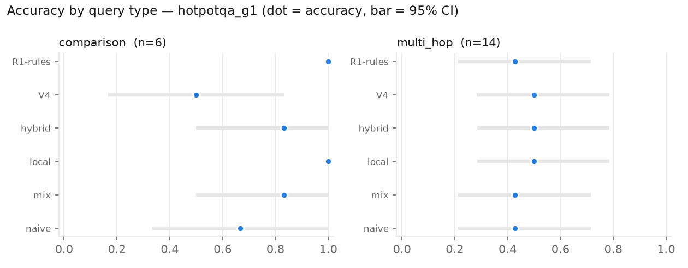
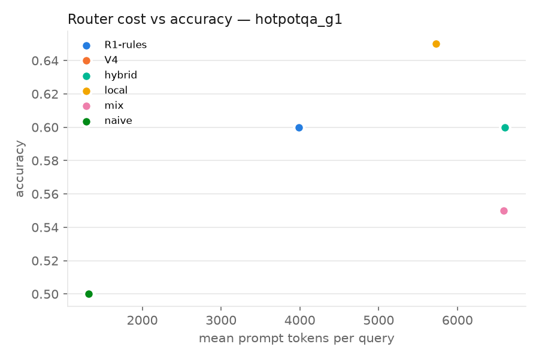
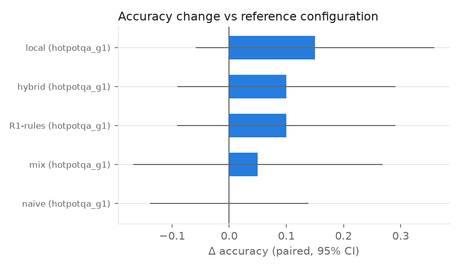

# Elevate-RAG results

## Runs

| experiment | variant | dataset | demo | n | accuracy | accuracy_ci | f1 | em | recall@10 | ndcg@10 | refusal_correct | error_rate | latency_p50_s | latency_p95_s | cache_hit_rate | prompt_tokens_mean | context_tokens_mean | cost_per_1k_queries_usd |
|---|---|---|---|---|---|---|---|---|---|---|---|---|---|---|---|---|---|---|
| G1-7B | R1-rules | hotpotqa_g1 | False | 20 | 0.600 | [0.400, 0.800] | 0.451 | 0.350 | 1.000 | 0.941 | 0.800 | 0.000 | — | — | 1.000 | 3991.050 | 2491.000 | 0.000 |
| G1-7B | V4 | hotpotqa_g1 | False | 20 | 0.500 | [0.300, 0.700] | 0.418 | 0.350 | 1.000 | 0.941 | 0.800 | 0.000 | 14.178 | 58.770 | 0.000 | 1326.800 | 1001.450 | 0.000 |
| G1-7B | hybrid | hotpotqa_g1 | False | 20 | 0.600 | [0.400, 0.800] | 0.477 | 0.350 | 0.975 | 0.930 | 0.850 | 0.000 | — | — | 0.550 | 6600.150 | 4006.950 | 0.000 |
| G1-7B | local | hotpotqa_g1 | False | 20 | 0.650 | [0.450, 0.850] | 0.388 | 0.250 | 0.900 | 0.860 | 0.850 | 0.000 | 115.660 | 217.632 | 0.000 | 5724.800 | 3397.650 | 0.000 |
| G1-7B | mix | hotpotqa_g1 | False | 20 | 0.550 | [0.350, 0.800] | 0.434 | 0.300 | 1.000 | 0.941 | 0.850 | 0.000 | — | — | 0.625 | 6584.150 | 3992.450 | 0.000 |
| G1-7B | naive | hotpotqa_g1 | False | 20 | 0.500 | [0.300, 0.700] | 0.431 | 0.300 | 1.000 | 0.941 | 0.750 | 0.000 | 27.781 | 42.665 | 0.500 | 1315.650 | 992.150 | 0.000 |

## Paired comparisons (McNemar, Holm-corrected)

| experiment | dataset | variant | reference | n | diff | ci_low | ci_high | p | p_holm | significant |
|---|---|---|---|---|---|---|---|---|---|---|
| G1-7B | hotpotqa_g1 | R1-rules | V4 | 20 | 0.100 | -0.091 | 0.291 | 0.625 | 1.000 | False |
| G1-7B | hotpotqa_g1 | hybrid | V4 | 20 | 0.100 | -0.091 | 0.291 | 0.625 | 1.000 | False |
| G1-7B | hotpotqa_g1 | local | V4 | 20 | 0.150 | -0.059 | 0.359 | 0.375 | 1.000 | False |
| G1-7B | hotpotqa_g1 | mix | V4 | 20 | 0.050 | -0.168 | 0.268 | 1.000 | 1.000 | False |
| G1-7B | hotpotqa_g1 | naive | V4 | 20 | 0.000 | -0.139 | 0.139 | 1.000 | 1.000 | False |

Differences whose CI includes 0 are *no clear difference*, not evidence of equivalence.

## Figures

