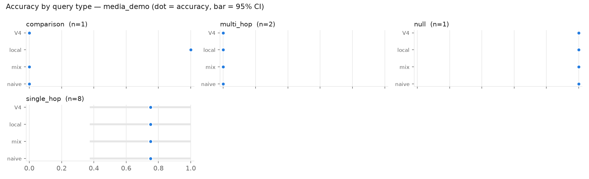
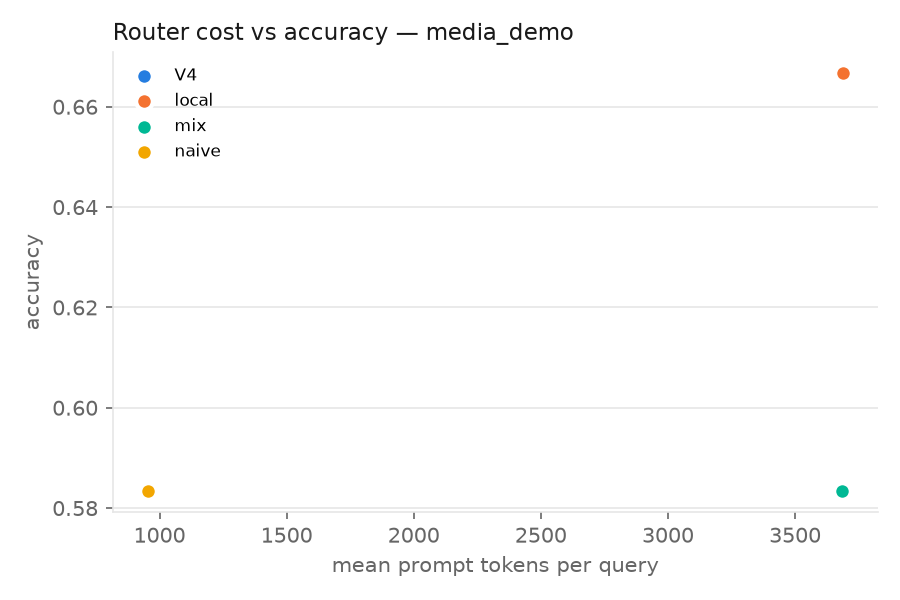
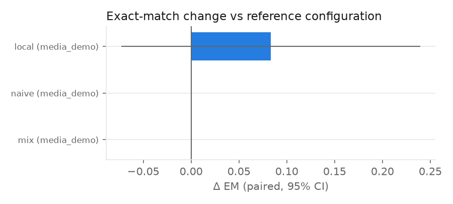

# Elevate-RAG results

**Primary metric: exact match (EM) and token F1**, the benchmarks' official, judge-free answer metrics. `accuracy` is the LLM judge's verdict; it counts only where `judge_status` is `validated` (GroUSE calibration passed for both judges and their agreement kappa >= 0.6 on this run's answers).

> Some runs have **unvalidated** judge scores: read `accuracy` there as indicative only.

## Runs

| experiment | variant | dataset | demo | n | em | em_ci | f1 | accuracy | accuracy_ci | accuracy_judge2 | judge_kappa | judge_status | recall@10 | ndcg@10 | refusal_correct | ragas_answer_correctness | ragas_faithfulness | ragas_context_precision | ragas_context_recall | error_rate | latency_p50_s | latency_p95_s | cache_hit_rate | prompt_tokens_mean | context_tokens_mean | cost_per_1k_queries_usd |
|---|---|---|---|---|---|---|---|---|---|---|---|---|---|---|---|---|---|---|---|---|---|---|---|---|---|---|
| MEDIA-7B | V4 | media_demo | False | 12 | 0.364 | [0.091, 0.636] | 0.474 | 0.583 | [0.331, 0.833] | — | — | unvalidated | 1.000 | 0.986 | 0.917 | 0.794 | 0.750 | 0.947 | 0.816 | 0.000 | 16.187 | 56.772 | 0.000 | 952.667 | 610.000 | 0.000 |
| MEDIA-7B | local | media_demo | False | 12 | 0.455 | [0.182, 0.730] | 0.565 | 0.667 | [0.417, 0.917] | — | — | unvalidated | 1.000 | 0.989 | 1.000 | 0.743 | 0.667 | 0.950 | 0.816 | 0.000 | 74.114 | 104.821 | 0.000 | 3687.417 | 1868.250 | 0.000 |
| MEDIA-7B | mix | media_demo | False | 12 | 0.364 | [0.091, 0.636] | 0.474 | 0.583 | [0.331, 0.833] | — | — | unvalidated | 1.000 | 0.986 | 0.833 | 0.682 | 0.667 | 0.947 | 0.816 | 0.000 | — | — | 0.542 | 3685.250 | 1867.250 | 0.000 |
| MEDIA-7B | naive | media_demo | False | 12 | 0.364 | [0.091, 0.636] | 0.474 | 0.583 | [0.331, 0.833] | — | — | unvalidated | 1.000 | 0.986 | 0.917 | 0.794 | 0.750 | 0.947 | 0.816 | 0.000 | — | — | 1.000 | 952.667 | 610.000 | 0.000 |

## Paired comparisons (McNemar, Holm-corrected)

| experiment | dataset | metric | variant | reference | n | diff | ci_low | ci_high | p | p_holm | significant |
|---|---|---|---|---|---|---|---|---|---|---|---|
| MEDIA-7B | media_demo | em | local | V4 | 12 | 0.083 | -0.073 | 0.240 | 1.000 | 1.000 | False |
| MEDIA-7B | media_demo | em | mix | V4 | 12 | 0.000 | 0.000 | 0.000 | 1.000 | 1.000 | False |
| MEDIA-7B | media_demo | em | naive | V4 | 12 | 0.000 | 0.000 | 0.000 | 1.000 | 1.000 | False |
| MEDIA-7B | media_demo | correct | local | V4 | 12 | 0.083 | -0.073 | 0.240 | 1.000 | 1.000 | False |
| MEDIA-7B | media_demo | correct | mix | V4 | 12 | 0.000 | 0.000 | 0.000 | 1.000 | 1.000 | False |
| MEDIA-7B | media_demo | correct | naive | V4 | 12 | 0.000 | 0.000 | 0.000 | 1.000 | 1.000 | False |

Differences whose CI includes 0 are *no clear difference*, not evidence of equivalence.

## Figures

