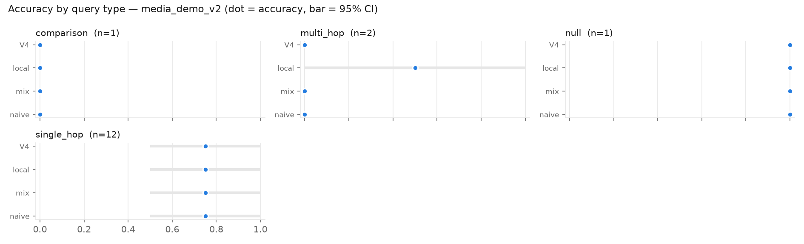
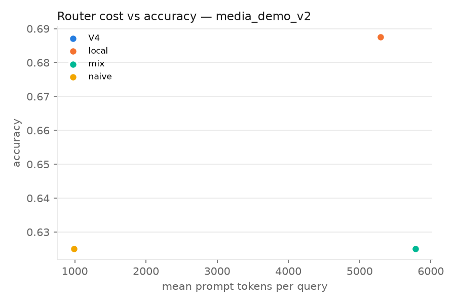
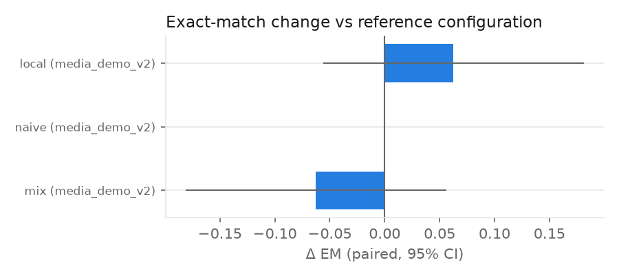

# Elevate-RAG results

**Primary metric: exact match (EM) and token F1**, the benchmarks' official, judge-free answer metrics. `accuracy` is the LLM judge's verdict; it counts only where `judge_status` is `validated` (GroUSE calibration passed for both judges and their agreement kappa >= 0.6 on this run's answers).

> Some runs have **unvalidated** judge scores: read `accuracy` there as indicative only.

## Runs

| experiment | variant | dataset | demo | n | em | em_ci | f1 | accuracy | accuracy_ci | accuracy_judge2 | judge_kappa | judge_status | recall@10 | ndcg@10 | refusal_correct | ragas_answer_correctness | ragas_faithfulness | ragas_context_precision | ragas_context_recall | error_rate | latency_p50_s | latency_p95_s | cache_hit_rate | prompt_tokens_mean | context_tokens_mean | cost_per_1k_queries_usd |
|---|---|---|---|---|---|---|---|---|---|---|---|---|---|---|---|---|---|---|---|---|---|---|---|---|---|---|
| MEDIA-7B-V2 | V4 | media_demo_v2 | False | 16 | 0.600 | [0.333, 0.867] | 0.654 | 0.625 | [0.375, 0.875] | — | — | unvalidated | 1.000 | 0.925 | 0.812 | — | — | — | — | 0.000 | 12.823 | 15.445 | 0.000 | 992.250 | 654.688 | 0.000 |
| MEDIA-7B-V2 | local | media_demo_v2 | False | 16 | 0.667 | [0.400, 0.867] | 0.757 | 0.688 | [0.438, 0.875] | — | — | unvalidated | 1.000 | 0.925 | 1.000 | — | — | — | — | 0.000 | 114.317 | 224.683 | 0.375 | 5295.562 | 2864.562 | 0.000 |
| MEDIA-7B-V2 | mix | media_demo_v2 | False | 16 | 0.533 | [0.267, 0.800] | 0.680 | 0.625 | [0.375, 0.875] | — | — | unvalidated | 1.000 | 0.925 | 0.938 | — | — | — | — | 0.000 | — | — | 0.688 | 5781.938 | 3160.562 | 0.000 |
| MEDIA-7B-V2 | naive | media_demo_v2 | False | 16 | 0.600 | [0.333, 0.867] | 0.654 | 0.625 | [0.375, 0.875] | — | — | unvalidated | 1.000 | 0.925 | 0.812 | — | — | — | — | 0.000 | — | — | 1.000 | 992.250 | 654.688 | 0.000 |

## Paired comparisons (McNemar, Holm-corrected)

| experiment | dataset | metric | variant | reference | n | diff | ci_low | ci_high | p | p_holm | significant |
|---|---|---|---|---|---|---|---|---|---|---|---|
| MEDIA-7B-V2 | media_demo_v2 | em | local | V4 | 16 | 0.062 | -0.056 | 0.181 | 1.000 | 1.000 | False |
| MEDIA-7B-V2 | media_demo_v2 | em | mix | V4 | 16 | -0.062 | -0.181 | 0.056 | 1.000 | 1.000 | False |
| MEDIA-7B-V2 | media_demo_v2 | em | naive | V4 | 16 | 0.000 | 0.000 | 0.000 | 1.000 | 1.000 | False |
| MEDIA-7B-V2 | media_demo_v2 | correct | local | V4 | 16 | 0.062 | -0.056 | 0.181 | 1.000 | 1.000 | False |
| MEDIA-7B-V2 | media_demo_v2 | correct | mix | V4 | 16 | 0.000 | 0.000 | 0.000 | 1.000 | 1.000 | False |
| MEDIA-7B-V2 | media_demo_v2 | correct | naive | V4 | 16 | 0.000 | 0.000 | 0.000 | 1.000 | 1.000 | False |

Differences whose CI includes 0 are *no clear difference*, not evidence of equivalence.

## Figures

