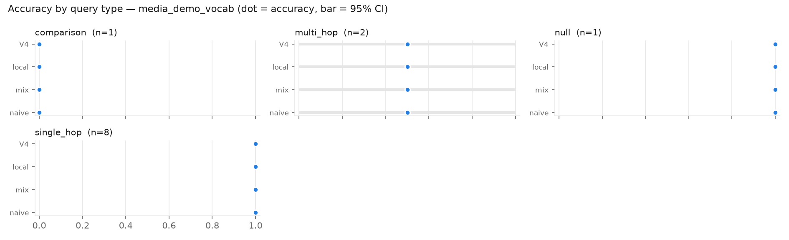
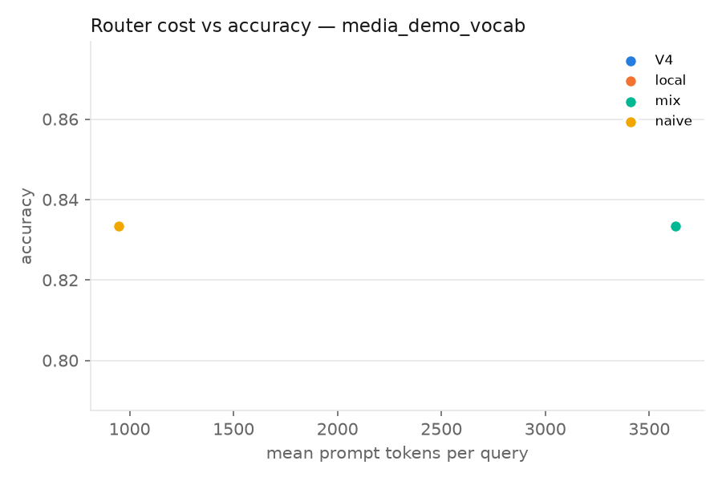
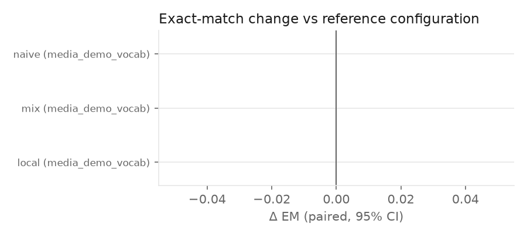

# Elevate-RAG results

**Primary metric: exact match (EM) and token F1**, the benchmarks' official, judge-free answer metrics. `accuracy` is the LLM judge's verdict; it counts only where `judge_status` is `validated` (GroUSE calibration passed for both judges and their agreement kappa >= 0.6 on this run's answers).

> Some runs have **unvalidated** judge scores: read `accuracy` there as indicative only.

## Runs

| experiment | variant | dataset | demo | n | em | em_ci | f1 | accuracy | accuracy_ci | accuracy_judge2 | judge_kappa | judge_status | recall@10 | ndcg@10 | refusal_correct | ragas_answer_correctness | ragas_faithfulness | ragas_context_precision | ragas_context_recall | error_rate | latency_p50_s | latency_p95_s | cache_hit_rate | prompt_tokens_mean | context_tokens_mean | cost_per_1k_queries_usd |
|---|---|---|---|---|---|---|---|---|---|---|---|---|---|---|---|---|---|---|---|---|---|---|---|---|---|---|
| MEDIA-7B-VOCAB | V4 | media_demo_vocab | False | 12 | 0.818 | [0.545, 1.000] | 0.864 | 0.833 | [0.583, 1.000] | — | — | unvalidated | 1.000 | 0.986 | 1.000 | — | — | — | — | 0.000 | 16.626 | 20.080 | 0.000 | 945.750 | 601.083 | 0.000 |
| MEDIA-7B-VOCAB | local | media_demo_vocab | False | 12 | 0.818 | [0.545, 1.000] | 0.864 | 0.833 | [0.583, 1.000] | — | — | unvalidated | 1.000 | 0.989 | 0.917 | — | — | — | — | 0.000 | — | — | 0.500 | 3629.000 | 1838.833 | 0.000 |
| MEDIA-7B-VOCAB | mix | media_demo_vocab | False | 12 | 0.818 | [0.545, 1.000] | 0.864 | 0.833 | [0.583, 1.000] | — | — | unvalidated | 1.000 | 0.986 | 1.000 | — | — | — | — | 0.000 | — | — | 0.542 | 3626.833 | 1837.833 | 0.000 |
| MEDIA-7B-VOCAB | naive | media_demo_vocab | False | 12 | 0.818 | [0.545, 1.000] | 0.864 | 0.833 | [0.583, 1.000] | — | — | unvalidated | 1.000 | 0.986 | 1.000 | — | — | — | — | 0.000 | — | — | 1.000 | 945.750 | 601.083 | 0.000 |

## Paired comparisons (McNemar, Holm-corrected)

| experiment | dataset | metric | variant | reference | n | diff | ci_low | ci_high | p | p_holm | significant |
|---|---|---|---|---|---|---|---|---|---|---|---|
| MEDIA-7B-VOCAB | media_demo_vocab | em | local | V4 | 12 | 0.000 | 0.000 | 0.000 | 1.000 | 1.000 | False |
| MEDIA-7B-VOCAB | media_demo_vocab | em | mix | V4 | 12 | 0.000 | 0.000 | 0.000 | 1.000 | 1.000 | False |
| MEDIA-7B-VOCAB | media_demo_vocab | em | naive | V4 | 12 | 0.000 | 0.000 | 0.000 | 1.000 | 1.000 | False |
| MEDIA-7B-VOCAB | media_demo_vocab | correct | local | V4 | 12 | 0.000 | 0.000 | 0.000 | 1.000 | 1.000 | False |
| MEDIA-7B-VOCAB | media_demo_vocab | correct | mix | V4 | 12 | 0.000 | 0.000 | 0.000 | 1.000 | 1.000 | False |
| MEDIA-7B-VOCAB | media_demo_vocab | correct | naive | V4 | 12 | 0.000 | 0.000 | 0.000 | 1.000 | 1.000 | False |

Differences whose CI includes 0 are *no clear difference*, not evidence of equivalence.

## Figures

